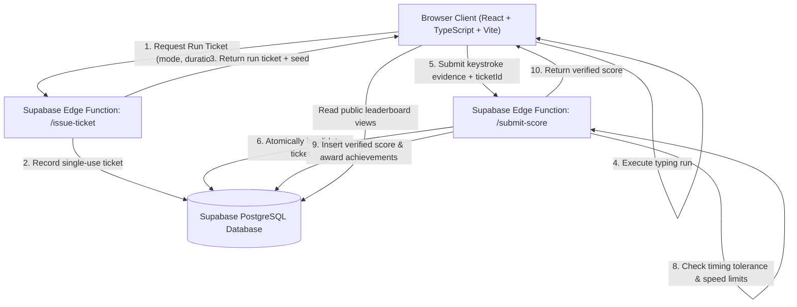

# WhenYahType

<div align="center">

```text
__        ___                  __   __     _   _____                  
\ \      / / |__   ___ _ __    \ \ / /_ _ | |_|_   _|   _ _ __   ___  
 \ \ /\ / /| '_ \ / _ \ '_ \    \ V / _` || '_ \| || | | | '_ \ / _ \ 
  \ V  V / | | | |  __/ | | |    | | (_| || | | | || |_| | |_) |  __/ 
   \_/\_/  |_| |_|\___|_| |_|    |_|\__,_||_| |_|_| \__, | .__/ \___| 
                                                    |___/|_|          
```

**Type fast. Wait harder.**

A competitive, minimalist typing arena built entirely around typing the phrase **"When Yah"**.

[](https://www.typescriptlang.org/)
[](https://react.dev/)
[](https://vitejs.dev/)
[](https://supabase.com/)
[](https://www.netlify.com/)
[](LICENSE)

</div>

---

## 🎯 The Concept

WhenYahType turns an internet meme into a polished, ultra-responsive typing competition. Inspired by the clean minimalism of Monkeytype, but featuring its own original visual identity, warm amber accents, Web Audio mechanical feedback, and authoritative anti-cheat infrastructure.

### Core Features

- **⚡ Fast Typing Engine:** Custom low-latency keystroke stream processor with zero layout shift, real-time WPM, raw WPM, accuracy, and phrase counting.
- **⏱️ Standard Modes:** 15s, 30s, 60s, and 120s endurance tests.
- **🔥 Daily Challenge:** Deterministic UTC challenge seed identical for every player on Earth with automatic UTC midnight countdown.
- **🛡️ Server-Side Anti-Cheat:** Single-use run tickets, timing bounds validation, and server-side score recalculation via Edge Functions.
- **🏆 Global Leaderboards:** All-Time, Daily, and Weekly leaderboards with strict tie-breaking (`WPM` → `Accuracy` → `Earliest Submission`).
- **👤 Player Profiles & Bests:** Personal records tracking per duration, achievement gallery, and public runner profiles (`/profile/:username`).
- **🎧 Tactile Audio:** Built-in mechanical keyboard sound synthesis via pure Web Audio API (zero external audio assets).
- **📱 Fully Responsive:** Adaptive monospace layout designed for both desktop keyboards and mobile touch devices.
- **🌐 Offline-First Play:** Play immediately as a guest; records sync when linked to Supabase.

---

## 🏗️ Architecture



---

## 🚀 Quick Start (Local Development)

### Prerequisites

- Node.js 20+
- npm or pnpm

### 1. Clone & Install

```bash
git clone https://github.com/Luxion-AI/WhenYahType.git
cd WhenYahType
npm install
```

### 2. Configure Environment

Copy `.env.example` to `.env.local`:

```bash
cp .env.example .env.local
```

```env
VITE_SUPABASE_URL=https://your-project.supabase.co
VITE_SUPABASE_ANON_KEY=your-publishable-or-anon-key
```

*(Note: WhenYahType runs smoothly in offline mode if Supabase keys are omitted, storing personal records and settings in local storage.)*

### 3. Run Development Server

```bash
npm run dev
```

Visit `http://localhost:3000` in your browser.

---

## 🧪 Testing & Quality Assurance

WhenYahType includes automated tests written with Vitest:

```bash
# Run all unit and anti-cheat test suites
npm test

# Build production bundle and strict TypeScript type check
npm run build
```

---

## 🗄️ Database & Security Setup

WhenYahType uses a normalized PostgreSQL schema with Row Level Security (RLS) enabled on all exposed tables.

### 1. Run Migrations

Execute `supabase/migrations/20261022000000_initial_schema.sql` in your Supabase SQL Editor or via Supabase CLI:

```bash
supabase db push
# or
psql -h db.your-project.supabase.co -U postgres -f supabase/migrations/20261022000000_initial_schema.sql
```

### 2. Seed Default Achievements

```bash
psql -h db.your-project.supabase.co -U postgres -f supabase/seed.sql
```

### 3. Deploy Edge Functions

```bash
supabase functions deploy issue-ticket
supabase functions deploy submit-score
```

---

## 🛡️ Anti-Cheat & Security Model

The browser client is considered **untrusted**:

1. **Single-Use Run Tickets:** Before starting, an authenticated client obtains a unique cryptographically generated ticket with duration and expiration limits.
2. **Authoritative Recomputation:** The server never trusts client-supplied WPM or accuracy. It reconstructs the expected deterministic target text from the seed and recalculates stats from the submitted raw typed characters.
3. **Elapsed Time Bounds:** Runs are rejected if elapsed time deviates beyond a narrow network jitter window (`[duration - 1.8s, duration + 8.0s]`).
4. **Velocity Sanity:** Keystroke velocities exceeding superhuman thresholds (320+ WPM) or spam bursts (< 25% accuracy) are rejected.
5. **No Direct Inserts:** Row Level Security (RLS) prevents browser clients from inserting or modifying rows in `typing_runs` or awarding achievements directly.

### Honest Limitations

While this eliminates casual score tampering, a client in a browser environment could theoretically synthesize timed DOM events. Further hardening could involve keystroke inter-arrival timing entropy analysis and bot CAPTCHAs.

---

## 🌐 Netlify Deployment

A pre-configured `netlify.toml` handles routing and security headers.

1. Build command: `npm run build`
2. Publish directory: `dist`
3. Environment variables: Add `VITE_SUPABASE_URL` and `VITE_SUPABASE_ANON_KEY` in the Netlify dashboard.

---

## 📜 License

MIT License. See [LICENSE](LICENSE) for details.
